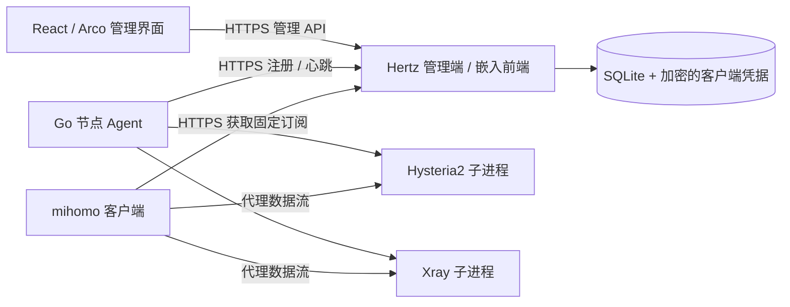

# 架构

## 进程与资源

管理端只管理节点、认证、状态和订阅，不安装协议核心，不转发代理流量。管理端是一个 Go 二进制，SQLite 是唯一数据库，React 编译产物嵌入其中；无 Redis、独立 Node 服务或额外数据库服务。

管理端可使用成对的 TLS_CERT_FILE / TLS_KEY_FILE 直接提供 HTTPS（最低 TLS 1.2），或由已有 HTTPS 入口转发到默认本地 HTTP 监听。证书申请、续期及更新后重启由部署者管理，不自动 ACME。

节点的 Go Agent 负责启动、监控、失败重启和停止两个协议子进程，并向管理端主动发请求；中心不需要 SSH 访问节点，也不需要连接节点管理端口。Hysteria2 负责 UDP/QUIC，Xray 负责 VLESS+REALITY TCP。管理平面短暂不可用时，已有节点继续运行代理核心。

Linux amd64/arm64 与 systemd 是首批安装目标。Docker、NAT、云安全组和不同网络的可达性需各自配置与验证。节点必须能向中心发 HTTPS 请求；同时客户端必须能访问节点公布的协议端口。只支持 HTTP 请求、没有长期进程或 UDP 能力的运行环境不能等同于完整代理节点。

1 CPU / 1 GiB 是部署目标，尚未在该规格 VPS 实测；实际容量需测量空闲/峰值 RSS、心跳并发、SQLite 写入和订阅渲染。前端构建应在开发机或独立构建机完成。仓库不配置自动构建或自动发布。

## 身份与凭据

- 节点持久化随机 ID，不使用容易变化的 IP 当身份。`manager_url` 接受 HTTPS 域名/IP和端口；`endpoints[].server` 是客户端连接节点的对外域名/IP，不从管理请求来源 IP 推断。
- 首次注册携带 enrollment key，管理端返回绑定到该节点 ID 的 token。Agent 将 token 保存在本地 `0600` 文件。已有 ID 的注册返回冲突，不覆盖已有身份。
- 节点本地生成并拥有代理运行凭据。REALITY 私钥、TLS 私钥始终留在节点。中心只收到导出客户端配置所需的密码、UUID、公钥、short ID、证书指纹等信息。
- 中心用对称密钥加密保存客户端凭据；普通节点列表不返回这些字段。SQLite 备份必须同时备份加密主密钥，密钥与数据库不要一起公开。
- 管理员 token、enrollment key、节点 token、订阅 URL token 有不同用途。撤销订阅 URL 只阻止再次下载，不会撤销已导出的代理凭据。
- 管理端不下发任意 shell 命令，也不负责从中心修改节点私钥。未来集中下发配置需要 desired/applied revision、应用确认和失败回滚，目前不要把本地配置与中心配置同时视作权威。

## 状态与同步

Agent 约每 30 秒发送心跳。启动后的首次心跳和配置摘要变化时附带完整 endpoints；普通心跳不重复发送秘密。中心显示最近心跳、Agent/核心状态、启用状态与地址信息。

心跳在线只代表控制面连通，子进程运行只代表本地运行状态。它们不证明客户端所在网络能通过代理访问目的站点。当前没有多地域协议探测或用户网络质量排名；客户端 `url-test` 是另外一层检查。

禁用节点后仍接收心跳，但订阅不会输出该节点。删除节点撤销其 token 并移除订阅中的选择；重新接入需要新的节点身份。不要复制初始化后的节点目录部署第二台机器。

## 数据与配置生成

核心对象为 Node（一台节点）、Endpoint（节点上的一个协议）、Subscription（节点选择及协议过滤）。Node 可对应多个 Endpoint。管理端保存配置所需的完整客户端字段，但列表和浏览器常规展示使用脱敏数据。

订阅 token 对应数据库中的当前选择。每次请求都重新读取节点和订阅，生成结构化 YAML；编辑、禁用、删除节点及修改订阅选择后，同一 URL 下一次刷新即反映变化。临时离线节点保留，避免链路波动造成订阅频繁变化。空集合输出有效的 DIRECT 配置。

YAML 面向 mihomo / Clash Meta，不承诺旧 Clash 内核兼容。Hysteria2 使用证书指纹固定，VLESS 使用 REALITY 公钥与 short ID。DNS 采用国内 DoH + `nameserver-policy` 前置分流与 `28.0.0.1/8` fake-ip；显式声明 `GLOBAL` 选择组并将 `🌍 代理` 置于首位，确保全局模式默认复用规则模式同款节点而非 `DIRECT`。Claude / ChatGPT / Google 三个专属分组均采用 `REJECT` 置顶的 `url-test`（30s 探测、`tolerance: 0`、全挂回退 `REJECT` 禁止直连并附带非 UDP 规则防泄漏兜底），支持在订阅内独立绑定纯净节点。

## 当前边界

已覆盖单管理员、节点主动注册/心跳、核心本地监控和动态订阅。尚无计费、配额、多租户隔离、自动云主机创建、中心远程配置下发、自动证书轮换、多地域健康探测或管理端多副本容灾。SQLite 适合当前单实例目标；扩容设计应在负载测量后进行。
