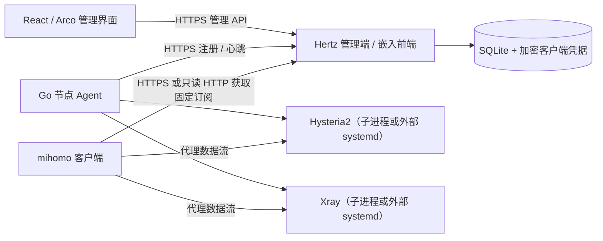

# 系统拓扑与进程边界

## 1. 业务规则（当前生效）

- **轻量单体控制面**：`proxy-manage-server` 为单一 Go 进程，内置 SQLite（`modernc.org/sqlite` 纯 Go 实现，WAL 模式）并通过 `go:embed` 直接托管编译后的 React / Arco Design 前端静态资源；不依赖 Redis、PostgreSQL 或独立 Node 服务，目标运行规格为 Linux 1 CPU / 1 GiB。
- **控制面与数据面物理隔离**：管理端仅负责节点认证、心跳状态跟踪与动态订阅渲染，不安装任何代理协议内核，不监听代理端口，不转发任何代理流量。
- **节点主动上报模型**：`proxy-server` 运行在各海外节点机，主动通过 HTTPS 向一个或多个管理端发起首次注册与每 30 秒心跳；管理端无需 SSH 登录节点，也无需反向拨入节点端口。管理平面短暂不可达时，节点代理数据流照常运行。
- **四类凭据职责隔离**：
  1. `ADMIN_TOKEN`：管理后台 UI 与 `/api/admin/*` 静态高熵令牌（前端存 `sessionStorage`）。
  2. `ENROLL_TOKEN`：新节点首次调用 `/api/agent/register` 的准入令牌，换取绑定节点随机 `ID` 的专属节点 Token（落盘为 `0600` 文件）。
  3. **节点客户端连接凭据与订阅 Token**：在管理端 SQLite 中由 32 字节主密钥（`DATA_DIR/master.key` 或 `MASTER_KEY`）经 AES-256-GCM 加密存储（`endpoints_enc`、`token_enc`）；常规节点列表接口对密码、UUID、公钥与 short ID 脱敏。
  4. **服务端私钥本地留存**：节点 TLS 私钥与 VLESS REALITY 私钥始终只保存在节点本地，绝不随注册或心跳上报给管理端。
- **连通性边界**：节点心跳在线（`online: true`）与核心进程存活（`running: true`）仅代表控制面与本机进程健康，不等同于客户端所在网络到节点公网 TCP/UDP 端口的实际连通性。

## 2. 跨端代码锚点

- **管理端入口与监听编排**：`cmd/proxy-manage-server/main.go`
- **控制面路由、存储与加解密**：`internal/manager/server.go`、`internal/manager/store.go`、`internal/manager/crypto.go`
- **共享领域与接口结构**：`internal/model/types.go`
- **嵌入前端资源与管理界面**：`internal/webui/webui.go`、`web/src/App.tsx`
- **节点 Agent 入口与运行循环**：`cmd/proxy-server/main.go`、`internal/agent/run.go`

## 3. 模块红线

- 严禁在 `proxy-manage-server` 部署或代码中引入代理监听器、流量转发或协议核心。
- 严禁将节点服务端私钥写入 `config.json` 或发送至管理端；严禁将运行态凭据、SQLite 文件或生成的客户端 YAML 提交至 Git。
- 备份或迁移管理端 SQLite 数据库时，必须同时备份对应的 `master.key`（或 `MASTER_KEY`）；丢失或单独更换主密钥会导致存量节点凭据与订阅链接无法解密。
- 删除或撤销节点后，其旧节点 ID 与旧节点 Token 永久失效（返回 `401`/`409`）；严禁克隆已初始化的节点目录去部署第二台机器。
